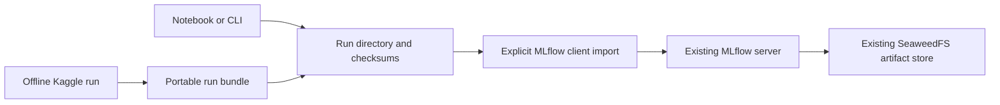

# Showcase a run while reusing shared infrastructure

This repository owns modeling and runtime clients. Shared MLflow, SeaweedFS, PostgreSQL and any Prefect server remain outside the competition repository. This refactor changes no shared services.



## Optional existing-tracker import

```bash
uv sync --locked --group dev --group lab --group data --group tracking
export MLFLOW_TRACKING_URI=http://your-existing-tracker:5000
.venv/bin/iceberg track --run-dir .local/my-run
```

The endpoint is an example. Configure a route reachable from the runtime: localhost inside a container refers to that container. The client verifies artifact checksums, detects repeated logical run IDs and refuses conflicting or incomplete imports. It does not promote a production model.

The client passes an isolated SQLite-backed MLflow integration test: artifact upload and retrieval, repeated-import detection and rejection of conflicting evidence. Run that test with `uv sync --locked --group dev --group tracking --group tracking-test` followed by `.venv/bin/pytest -q`. Import into the user's shared stack remains unverified. Training retains local evidence independently of tracking availability.

## A SeaweedFS folder visible in Lab

If infrastructure already supplies a client-side mount:
```bash
export SEAWEED_MOUNT=/absolute/path/to/existing/client-mount
docker compose -f compose.yaml -f compose.seaweed.yaml up -d lab
```

It appears read-only at `/shared`. This override creates neither a FUSE mount nor a SeaweedFS deployment. Never point it at the storage server's internal volume. MLflow's artifact proxy is a separate route and need not expose S3 administration credentials to notebooks.

## Evidence for the public case study

Show the recipe, source/input/split identities, measured validation, checkpoint reload and output checks. Screenshots can explain a connected workflow after it exists; they do not replace traceable artifacts. The first verified workflow is CPU execution and local evidence.

Prefect orchestration, W&B mirroring and the shared-service/Kaggle round-trip remain follow-up integrations. They are not completed features of this PR.
