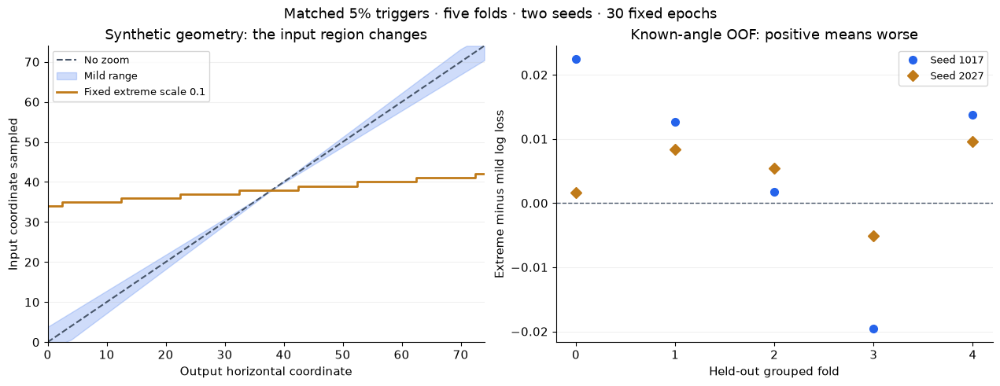

# What the zoom experiment can establish

Extreme zoom raises the paired ensemble known-angle OOF log loss by **0.004056** versus mild zoom. The two seed deltas are **+0.006397** and **+0.003993**; **8/10** paired seed/fold deltas worsen and **2/10** improve.

Extreme zoom has higher loss on the primary ensemble metric in this controlled setting. That does not establish a universally harmful transform or a defect in the historical model. Paired fold effects have mixed signs; retain that variation rather than treating the average as unanimous evidence. The normal training default remains unchanged. These are retrospective grouped-OOF results, not a new leaderboard score or a replay of the old Keras model.

[Executed walkthrough](../notebooks/03-zoom-severity.ipynb) · [Aggregate evidence](zoom-study.json) · [Protocol committed before fitting](zoom-study-protocol.md)

## Why the old setting deserved a check

The old call is a legal API use. In Keras 2, `(0.1, 0.1)` fixes both output-to-input affine scales at 0.1; it does not request +/-10% zoom. On a synthetic 75×75 coordinate grid, the historical geometry samples coordinates 34–42 and stretches that central region across the output. It is roughly 10x linear magnification. The old training generator enables this transform at 5%, not on every observation.

Two explanations were plausible: removing spatial context might make the augmentation harmful, while occasional aggressive crops might still improve robustness to local cues. Geometry alone cannot settle either explanation or establish what the author intended. The historical file was introduced without a stated rationale for the range; the known commit history does not resolve intention. The [Keras 2.0.8 source](https://github.com/keras-team/keras/blob/2.0.8/keras/preprocessing/image.py) supplies the parameter semantics. This is a documented Keras-2 geometry check, not proof of the exact unpinned 2017 runtime.

## Compare settings, not different experiments

Use all **1,604** labeled observations with the same five angle-grouped folds, split seed 25, model seeds 1017/2027, metadata CNN, training-only preprocessing, batch size, optimizer and **30 fixed epochs**. Evaluate the final epoch, with four-flip inference fixed. Every arm consumes the same augmentation random draws and uses the same 5% trigger schedule; the no-zoom control applies identity on those triggers.

The primary population is the **1,471 known-angle** observations, matching test metadata availability. Report the **133 missing-angle ships** separately and keep all rows. Exact angle is an acquisition proxy rather than a verified scene ID; the study is retrospective and the overlapping folds/two seeds do not supply independent replications or confidence intervals.

All study arms remove the scale coupled to the normal rotation/shift block and insert an isolated Keras-style zoom with historical centering, nearest interpolation/fill. The remaining transforms are shared. Mild bounds sample each axis independently; the extreme bounds fix both axes. This estimates the effect of those policy settings in a common modern pipeline. It does **not** estimate replacement of the normal default, which retains its existing coupled affine augmentation. No benchmark, threshold, blend weight, checkpoint policy or public/private leaderboard score is changed.

## Retain every condition and seed

Lower log loss is better. OOF ensembles average the two seeds' held-out probabilities before scoring; ensemble loss is not the mean of seed losses.

| Training condition | Known-angle OOF loss | All-row OOF loss | Missing-angle loss | Seed 1017 known loss | Seed 2027 known loss |
|---|---:|---:|---:|---:|---:|
| No zoom | 0.220037 | 0.204135 | 0.028262 | 0.225254 | 0.224270 |
| Mild zoom, 5% | 0.222293 | 0.206283 | 0.029212 | 0.227270 | 0.227202 |
| Extreme zoom, 5% | 0.226349 | 0.209681 | 0.025324 | 0.233668 | 0.231195 |



All signed deltas are **after minus before**; positive means greater loss. The receipt retains every seed/fold result, all-row and missing-angle deltas, high-loss concentration and fingerprints, rather than selecting favorable cases. The plots show observations, not confidence intervals.

## Why the average is not the whole answer

The exception is repeatable: **fold 3 improves in both seeds**, while the other four folds worsen in both. The result is therefore not driven by one unlucky seed, but it is not unanimous across acquisition-proxy folds either. It does not reveal which image or acquisition properties explain the exception.

The cohort direction also differs: extreme zoom lowers missing-angle loss from **0.029212 to 0.025324**, while increasing known-angle loss from **0.222293 to 0.226349**. The missing-angle cohort contains only 133 ships and is absent from test metadata; its improvement does not establish a test-relevant benefit. Keeping the known-angle endpoint primary avoids hiding that asymmetry in the pooled result.

No zoom has the lowest known-angle loss **among these three study arms**. That is not a direct comparison with the existing default, whose coupled affine scale was deliberately removed from every study arm.

## The engineering decision


Keep the current default and historical scores intact. Recording `zoom_policy` in each saved configuration makes the training difference auditable without monkeypatching augmentation or adding a project CLI. The useful change is the evidence standard: distinguish an extreme but legal transform, its measured effect under a named protocol, and a confirmed unintended defect. The old geometry is real; the author's intention remains unknown. Even a consistent OOF effect here would not establish its effect on the original historical leaderboard model.

A default change would need a separately predeclared comparison against the actual current recipe and an independent assessment population. That is a follow-up question, not an implied extra search in this task. No difficult observations were removed and no model was selected using the reported paired outcomes.

## Source, reconstruction and reproduction

The frozen study source is [`dd55e74`](https://github.com/cttsai1985/kaggle-statoil-iceberg-solution/tree/dd55e74364687cfa4e464208cab7db16ebb8930a). The full analyzer hash matches the plan's pre-fit hash. Input SHA-256 is `a56756a2528a09b139dc2747e2e40d869f9da7a8c9df37b188b6163f6bfb8696`; fold-assignment SHA-256 is `ab8290b8151dff121b59a1da540353670315a8b0afef6f65b3134bae4a09ec06`. All **30** independently reloaded checkpoints reconstruct saved validation probabilities within **0** maximum absolute difference (declared tolerance 1e-7).

A separate check executes the pre-study and study default functions on the same current NumPy/SciPy stack, using 100 synthetic augmentation seeds. All outputs are byte-identical; source/input/output hashes and the exact environment are retained in `default_equivalence` in the aggregate receipt. It is not a 2017 environment replay. CPU fitting used four workers × two threads; wall times and environments remain in the receipt.

The numerical dependencies matched the frozen lock. During fitting, the editable installation reported
`0.2.0.dev1` distribution metadata while
the frozen lock identified `0.2.0.dev2`.
This stale metadata was constant across all fits; the loaded code is identified by its clean
commit and package hash. It is disclosed rather than relabeled as a matching package version. Release packaging subsequently aligns the editable installation with the project/module/lock version; the original training receipt remains as measured.

The [protocol](zoom-study-protocol.md) gives the fitting command. A fresh output is required. To independently rebuild the aggregate from an existing complete private run, use the frozen source and:

```bash
.venv/bin/python scripts/study_zoom.py --data "$ICEBERG_DATA_DIR/train.json" \
  --output .local/zoom-study-2026-11-10 --analyze-only
```

The executed notebook reads only the public aggregate JSON and needs neither competition images nor weights. Raw images, IDs, probabilities, checkpoints and logs remain in ignored local artifacts. No Kaggle submission or shared-service operation was performed.
